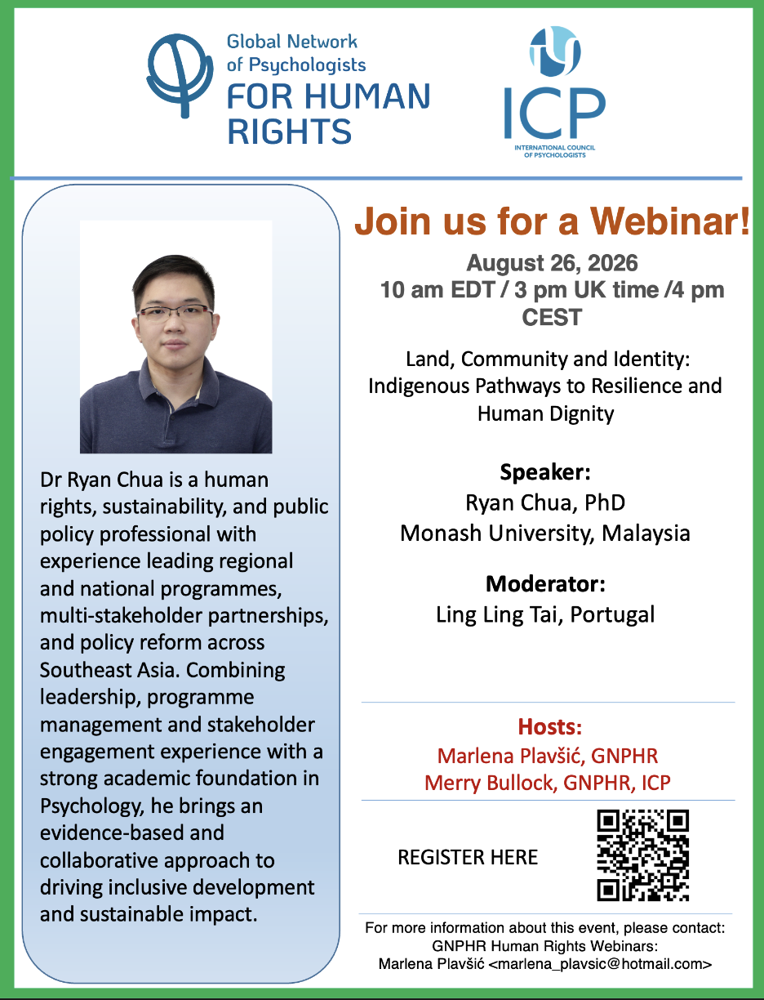

+++
date = '2026-08-30T00:00:00+00:00'
draft = false
categories = 'webinar'
summary = 'Dr Ryan Chua speaks about resilience of indigenous communites in Malaysia. Moderated by Ling Ling and hosted by the International Council of Psychologists (ICP)'
title = 'Land, Community and Identity: Indigenous Pathways to Resilience and Human Dignity'
+++

{style="width:70%;"}

## Overview

**Speaker**: Dr Ryan Chua  
**Moderator**: Ling Ling Tai

Dr Ryan Chua shared about how indigenous people remain reslience in the face of human rights abuses, such as discrimination, dispossession of land, forced displacement, and marginalisation. His research focused on the Semai community, in Peninsular Malaysia. The aim of the study was to
- contextualise understanding of resilience
- understanding the mechanisms and factors that affect resilience

This [webinar](https://youtu.be/8G5vvxcw02Y?si=aEeq2qdwSMxaoARE) took place on the **26th August 2026**. It was hosted by the [International Council of Psychologists (ICP)](https://icpweb.org) and the [Global Network of Psychologists for Human Rights (GNPHR)](https://humanrightspsychology.org/webinars/).

<iframe width="560" height="315" src="https://www.youtube.com/embed/8G5vvxcw02Y?si=6HqAn0qAlg0knz_w" title="YouTube video player" frameborder="0" allow="accelerometer; autoplay; clipboard-write; encrypted-media; gyroscope; picture-in-picture; web-share" referrerpolicy="strict-origin-when-cross-origin" allowfullscreen></iframe>